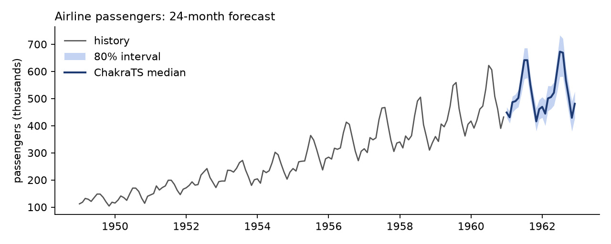
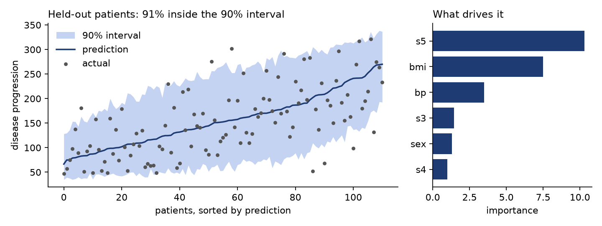

# YHat Labs Python Library

[](https://pypi.org/project/yhatlabs/)
[](https://pepy.tech/projects/yhatlabs)
[](https://pypi.org/project/yhatlabs/)
[](https://yhatlabs.com/models/docs)
[](https://colab.research.google.com/github/yhatlabs/yhatlabs-cookbook/blob/main/getting-started/chakrats.ipynb)
[](https://github.com/yhatlabs/yhatlabs-python/blob/main/LICENSE)

The Python library for YHat Labs' hosted foundation models. Get accurate predictions and forecasts on your data, with no
training required:

- **ChakraTS** forecasts any time series, with a range of likely values around every step: a drop-in alternative to
  ARIMA, Prophet or a model you train yourself.
- **ChakraTab** predicts a column of a table, with probabilities or intervals, and is typically more accurate than tuned
  gradient boosting such as XGBoost or LightGBM on public benchmarks.

## Quick start

> **Try it in Colab first:** the getting-started notebooks for
> [ChakraTS](https://colab.research.google.com/github/yhatlabs/yhatlabs-cookbook/blob/main/getting-started/chakrats.ipynb) and
> [ChakraTab](https://colab.research.google.com/github/yhatlabs/yhatlabs-cookbook/blob/main/getting-started/chakratab.ipynb)
> take a few minutes each.

```sh
pip install yhatlabs
export YHAT_API_KEY="<your-key>"   # create one at https://yhatlabs.com/models/signup
```

Extras: `[sklearn]` for the scikit-learn estimators, `[plot]` for charts, `[parquet]` and `[fast]` for large tables, or
`[all]`. The client reads the key from the environment (or `Client(api_key=...)`), so it never ends up in your code. Every
option is in the [docs](https://yhatlabs.com/models/docs). To run a model on your own machine with no API key, see
[yhatmodels](https://github.com/yhatlabs/yhatmodels).

## Time-series forecasting

Forecast one series or many; every forecast comes with a range around the most likely path.

```python
import pandas as pd
from yhatlabs import Client

url = "https://raw.githubusercontent.com/jbrownlee/Datasets/master/"
df = pd.read_csv(url + "airline-passengers.csv")

yh = Client()
fc = yh.forecast(df, h=24, time_col="Month", target_col="Passengers", level=[80])
print(fc.df.head(3))
```

```
  unique_id      Month    q10  median    q90
0  series_0 1961-01-01  430.5   448.5  468.0
1  series_0 1961-02-01  408.9   430.9  452.0
2  series_0 1961-03-01  449.0   486.7  508.2
```



For many series, add an id column (`unique_id`, `id` or `item_id`). Time and target columns are found by name too, and the
client infers the frequency, fills missing timestamps and splits large inputs for you.

### What you can do

| Goal | Call |
|---|---|
| Forecast with a range of outcomes | `yh.forecast(df, h)` |
| More accurate, a little slower | `yh.forecast(df, h, preset="pro")` |
| Wide intervals for rare outcomes (95%, 99%) | `yh.forecast(df, h, level=[95, 99])` |
| Totals, peaks and runs over the horizon | `yh.forecast(df, h, samples=1000)`, then `fc.sample_paths()` |
| The chance of crossing a limit | `fc.prob(above=limit)` |
| Use inputs you know ahead (prices, weather, promotions) | `yh.forecast(df, h, known=[...], future=...)` |
| Add calendar effects (hour, weekday, holidays) | `yh.forecast(df, h, calendar=True)` |
| Fine-tune on your own series | `tuned = yh.tune(df, h)`, then `yh.forecast(df, h, tune=tuned)` |
| Measure accuracy on your own history | `yh.evaluate(df, h, windows=3)` |
| Compare with the forecast you use today | `yh.evaluate(df, h, compare={"current": mine})` |
| Ask "what if" (a heatwave, a price change) | `yh.scenarios(df, h, {"base": f0, "heatwave": f1}, known=[...])` |
| Flag unusual points | `yh.detect_anomalies(df)` |
| Flag unusual points as they arrive | `stream = yh.anomaly_stream()`, then `stream.update(new_points)` |
| See how much each input moves the forecast | `yh.explain_forecast(df, h, known=[...], future=...)` |
| Fill gaps inside series | `yh.fill_gaps(df)` |
| Forecasts that add up (stores, regions, total) | `yhatlabs.hierarchy.aggregate(...)`, then `hierarchy.reconcile(fc, tree)` |

### Inputs and uncertainty

```python
from yhatlabs.features import make_future

future = make_future(df, h=24)            # the next 24 timestamps of every series
future["temperature"] = weather_forecast  # fill in what you know ahead

fc = yh.forecast(df, h=24, known=["temperature"], future=future, calendar=True, quantiles=[0.05, 0.5, 0.95])
fc.plot(history=df)
```

- **Uncertainty:** the median plus the 0.1 and 0.9 quantiles by default; `quantiles=` takes any levels and `level=[80, 95]`
  gives intervals. Intervals are calibrated on each series' past windows. `mean=True`, `samples=N` and `history=True` add
  the mean, sample paths and forecasts of earlier windows.
- **Covariates:** `known=[...]` (with their future values in `future=`, or in rows after the last value), `past=[...]`
  observed only in the history, `static=[...]` constants per series, and `calendar=True` (or `{"holidays": "US"}`).
- **Several targets per series:** `target_col=["load", "price"]` forecasts them jointly.

### Backtesting

```python
ev = yh.evaluate(df, h=24, windows=4, time_col="Month", target_col="Passengers")
ev.summary      # accuracy per model, and skill vs seasonal naive
ev.calibration  # does the 80% interval really hold 80%?
```

`evaluate` forecasts from several points near the end of each series, using only the data before each, and scores against
what happened. `skill_<metric>` above 0 beats the baseline; `ev.plot_calibration()` draws the calibration.

### Anomalies and gaps

```python
flags = yh.detect_anomalies(df, h=24, windows=5)  # a score and an anomaly flag for each recent point
filled = yh.fill_gaps(df)                         # missing values filled from the history before each gap
```

A point's score is its distance from the median forecast made before it, in units of that forecast's spread; `threshold`
(default 3) sets what gets flagged. Filled values are marked in `<target>_filled`.

## Tabular prediction

ChakraTab learns from your labeled rows and predicts new ones, with numbers, categories, dates and missing values as they
are.

```python
from sklearn.datasets import load_breast_cancer
from sklearn.model_selection import train_test_split
from yhatlabs import Client

X, y = load_breast_cancer(return_X_y=True, as_frame=True)
X_train, X_test, y_train, y_test = train_test_split(X, y, random_state=0)

yh = Client()
model = yh.fit(X_train.assign(diagnosis=y_train), target="diagnosis")
res = model.predict(X_test)
print(res.df.head(3))
```

```
     prediction    p_0    p_1
512           0  1.000  0.000
457           1  0.013  0.987
439           1  0.000  1.000
```

The fit happens once, on our side; later predictions send only the new rows. For a number, ask for an interval too:

```python
model = yh.fit(train, target="progression", task="regress")
res = model.predict(test, quantiles=[0.05, 0.5, 0.95])  # prediction, q5, median and q95 for every row
model.importance(holdout)                                # which columns drive the predictions
```



### What you can do

| Goal | Call |
|---|---|
| Classify (with probabilities) or regress | `yh.fit(train, target).predict(test)` |
| Get prediction intervals for numbers | `model.predict(test, quantiles=[0.05, 0.95])` |
| Get sets of likely classes | `model.predict(test, set_coverage=0.9).prediction_sets` |
| Validate on new machines, patients or periods | `yh.fit(train, target, groups="machine")` or `time_col="date"` |
| Measure accuracy and calibration on your table | `yh.evaluate_table(df, target, cv=5)` |
| See how one column moves the prediction | `model.effect("temperature")` |
| See which columns matter | `model.importance(holdout)` |
| Find rows unlike the training rows | `yhatlabs.outliers(train, test)` |
| Reuse a fit later, anywhere | `model.save("model.json")`, then `yhatlabs.load("model.json")` |
| Predict once, without saving a fit | `yh.predict(train, target, test)` |
| Fill missing cells | `yh.impute(df)` |
| Use it in scikit-learn | `ChakraTabClassifier()`, `ChakraTabRegressor()` |
| Compare with standard models on the same rows | `yh.predict(train, target, test, compare=True)`, then `res.comparison.score(actual, ChakraTab=res)` |
| Standard models alone, on the same split | `yh.compare(train, target, test)` |
| Run a large table in the background | `job = yh.fit(train, target, background=True)`, then `job.wait()` |
| Know the cost before you run | `yh.estimate_table(train, target=..., test=...)` |

### Fitting, intervals and importance

- **Lifetime:** a fit is kept 30 days after its last use (`ttl_days=` 1 to 365), or until `model.delete()`;
  `model.save(path)` writes a record that `yhatlabs.load()` reattaches anywhere.
- **Outputs:** classification gives `predictions`, `probabilities` and, with `set_coverage=`, sets of likely classes;
  regression gives `predictions` and, with `quantiles=`, calibrated intervals. Use `task=` for integer targets.
- **Rows that belong together:** `groups="machine"` (or `time_col=`) validates on whole groups or later periods.
- **Presets:** `fast` (default, seconds), `medium` (more accurate, 2-3x slower) and `pro` (most accurate, 4-8x slower).
- **Large tables** run as a background job automatically; `background=True` returns the job at once.
- **Importance** is how much the score drops when a column is shuffled; use labeled rows the model has not seen.

### scikit-learn

```python
from yhatlabs.integrations import ChakraTabClassifier
from sklearn.model_selection import cross_val_score

cross_val_score(ChakraTabClassifier(preset="medium"), X, y, cv=5)
```

The estimators fit once, reuse the fit and pickle; `ChakraTabRegressor.predict_quantiles(X)` gives intervals.

## Check your data first

`check` looks at your data locally, for free, before anything is sent, and says what to fix.

```python
import yhatlabs

yhatlabs.check(df, h=24)               # series: duplicates, gaps, frequency, short history, extreme values
yhatlabs.check(train, target="churn")  # tables: id-like columns, columns that leak the target, imbalance
```

## Advanced usage

<details>
<summary><b>Command line and coding agents</b></summary>

Everything above runs from the terminal, on CSV or parquet files.

```sh
yhatlabs check sales.csv --h 28
yhatlabs forecast sales.csv --h 28 --level 80 -o forecast.csv
yhatlabs evaluate sales.csv --h 28 --windows 3
yhatlabs anomalies meters.parquet --only
yhatlabs predict train.csv --target churn --test new.csv -o scored.csv
yhatlabs whoami
```

`--json` on any command gives machine-readable output; `yhatlabs models`, `usage`, `limits` and `fits` show your account.
`yhatlabs skills install` teaches coding agents (Claude Code, Cursor, Codex) the calls and the rules. `yhat` works too.

</details>

<details>
<summary><b>Async</b></summary>

```python
from yhatlabs import AsyncClient

async with AsyncClient() as yh:
    fc = await yh.forecast(df, h=24)
    model = await yh.fit(train, target="churn")
```

</details>

<details>
<summary><b>Configuration and visibility</b></summary>

| Setting | How |
|---|---|
| API key | `Client(api_key=...)` or `YHAT_API_KEY` |
| Server | `base_url=` or `YHAT_BASE_URL` (default `https://api.yhatlabs.com`) |
| Timeout and retries | `timeout=` (default 300 s), `max_retries=` (default 3); for one call, `yh.with_options(timeout=1800)` |
| Parallel requests | `max_concurrency=` (default 4) |
| Column names | `mask_columns=True` sends them as `c0`, `c1`, ...; results keep your names |
| Request logging | `YHAT_LOG=info`: method, path, status, time and request id (never data or keys) |
| Activity line | shown for calls over 2 s; `YHAT_PROGRESS=0` turns it off |

`yh.whoami()` checks your key. Every result carries `.provenance` (model, settings, request ids, SDK version, input
fingerprint) and `.timing`. Polars, Spark, Dask and Ray inputs work wherever pandas does.

</details>

<details>
<summary><b>Errors and retries</b></summary>

- `DataError` (fix the input) and `UnsupportedError` (the model can't do this) are raised before anything is sent.
- `APIError` and its subclasses carry `.status`, `.type` and `.request_id`; quote the request id to us and we can trace it.
- Timeouts, connection errors, 408, 409, 429 and 5xx are retried with backoff; every POST carries an `Idempotency-Key`, so a
  retry never runs twice.
- For large forecasts, `on_error="warn"` returns the batches that succeeded and lists the rest in `fc.errors`.

</details>

<details>
<summary><b>Your data</b></summary>

Inputs are sent to the YHat Labs API and kept as our [privacy policy](https://yhatlabs.com/privacy) describes; a saved fit is
kept until it expires or you delete it. `store=False` keeps a call out of your Logs, and `mask_columns=True` keeps column
names on your machine. See [SECURITY.md](https://github.com/yhatlabs/yhatlabs-python/blob/main/SECURITY.md) for how keys
and data are handled.

</details>

<details>
<summary><b>Examples</b></summary>

Runnable scripts in [`examples/`](https://github.com/yhatlabs/yhatlabs-python/tree/main/examples): energy load with weather
and a heatwave scenario, sensors with gaps and a fault, stores that add up to a region, a fit with intervals and
importance, a decision threshold set from business costs, validation for rows that arrive over time, and a comparison with
gradient boosting. More notebooks are in
the [cookbook](https://github.com/yhatlabs/yhatlabs-cookbook).

</details>

<details>
<summary><b>Development</b></summary>

```sh
git clone https://github.com/yhatlabs/yhatlabs-python && cd yhatlabs-python
uv venv && uv pip install -e ".[dev]"
.venv/bin/pytest -m "not live"      # offline tests against a fake API
```

See [CONTRIBUTING.md](https://github.com/yhatlabs/yhatlabs-python/blob/main/CONTRIBUTING.md) for the checks, the changelog
rule and how releases are made.

</details>

## Support

Open an issue (include the `request_id` from any error, never your key), or write to founders@yhatlabs.com.

## License

Apache-2.0
